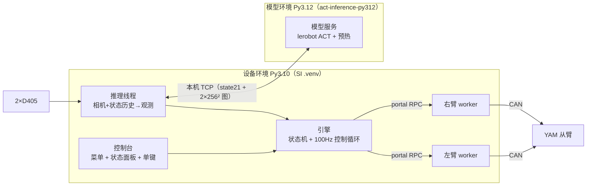
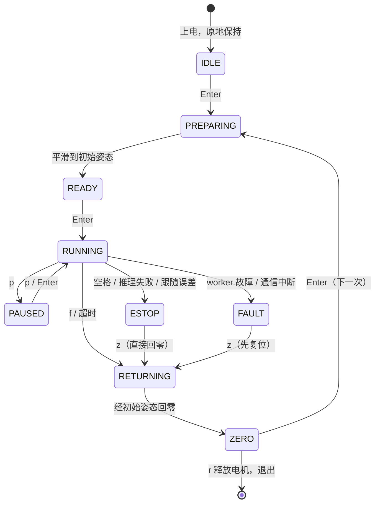

# ACT_deployment_new — ACT 推理与真机部署

自包含工程：把整个文件夹放到 `mvig-ubuntu` 的 SI 仓库根目录下（`<SI>/ACT_deployment_new`），`bash start.sh` 即可。
开发约定见 [AGENTS.md](AGENTS.md)，开发记录见 [changelog.md](changelog.md)，原理解释见 [docs/concepts.md](docs/concepts.md)。



## 快速上手

| 步骤 | 命令 / 操作 |
|---|---|
| 放权重 | `checkpoints/<任务目录>/<run名>/pretrained_model/`（完整目录，不要只拷 safetensors）。已放入 4 个 v3 权重 |
| 环境自检（只读） | `bash start.sh --check` → `ALL OK` |
| 离线自测 | `bash start.sh --selftest` |
| 启动 | `bash start.sh` → ①任务 ②权重 ③模式 ④执行方式 → 确认 |
| 救援 | `bash start.sh --rescue`（控制台异常退出后手臂仍通电时；`start.sh` 也会自动询问） |
| 非交互 | `bash start.sh --task block_into_cup --checkpoint v3_long2_017000 --mode shadow --preset chunk_10` |

> 解释器路径默认取上一级 SI 仓库的两个已有环境；不同的话复制 `local.env.example` 为 `local.env` 修改。

### 三种模式

| 模式 | 机械臂 | 相机 | 模型 | 用途 |
|---|---|---|---|---|
| 真机执行 `real` | 真 | 真 | 真 | 正式执行 |
| 影子模式 `shadow` | 真（只做初始化/回零） | 真 | 真 | 执行阶段**只推理不动作**，面板显示"模型想要"的目标；首次上机推荐 |
| 模拟演练 `sim` | 模拟 | 合成画面 | 真 | 无硬件检查链路与延迟 |

### 按键（无需回车）

| 键 | 作用 |
|---|---|
| `Enter` | 下一步：移动到初始姿态 → 开始执行 → （暂停时）继续 |
| `f` | 结束本次执行 → 经初始姿态平滑回零位 |
| `p` | 暂停（原地保持）/ 继续 |
| `空格` | **急停**：立即原地保持，推理停止 |
| `z` | 回零位（急停/故障后 = 紧急回零，直接回零；故障会先复位 worker） |
| `i` | 回初始姿态 |
| `r` / `q` | 回零位后释放电机并退出 |
| `h` | 帮助 |
| `Ctrl+C` | 1 次急停 · 2 次回零释放退出 · 3 次立即退出（worker 保持通电 → start.sh 自动救援） |

### 一次执行的流程



## 目录

```text
ACT_deployment_new/
├─ start.sh                 一键启动（--check / --selftest / --rescue）
├─ configs/
│  ├─ deploy.yaml           端口、相机、运动/安全限制、零位、执行方式预设
│  ├─ tasks.yaml            任务注册表：任务 → 权重目录、初始姿态、时长上限
│  └─ hardware.yaml         CAN / worker 端口 / 看门狗（SI 格式）
├─ checkpoints/<task>/<run>/pretrained_model/
├─ act_deploy/
│  ├─ model/spec.py         从 checkpoint 契约解析输入输出（换模型主要改这里/配置）
│  ├─ model/features.py     观测构造（含 100ms 速度、补零）、图像预处理、动作还原
│  ├─ server/policy_server.py  模型服务（唯一 import torch 的文件）：加载、预热、保温
│  ├─ ipc.py                本机 TCP 协议
│  ├─ control/              状态历史 / 计划调度 / 安全过滤 / 五次多项式轨迹
│  ├─ hw/                   worker（看门狗）、机械臂客户端、相机、只读预检
│  ├─ app/                  引擎（状态机）、控制台界面、入口、记录
│  └─ tools/                check_env / selftest / rescue
├─ tests/engine_failure_paths.py
├─ logs/<时间>_<任务>_<模式>/   session.json、events.log、server.log、worker_*.log、episodes/
└─ docs/                    concepts.md（原理）、vendored.md（硬件层组件说明）
```

## 常见改动去哪里

| 想改 | 位置 |
|---|---|
| 新任务 | `configs/tasks.yaml` 加一段 + `checkpoints/<目录>/` |
| 初始姿态 / 零位 | `tasks.yaml` `start_pose` / `deploy.yaml` `poses.zero` |
| 初始化/回零速度 | `deploy.yaml` `motion` |
| 平滑方式 | `deploy.yaml` `execution.presets`（启动时选择） |
| 模型输入输出变了 | 先看契约文件能否表达；否则 `tasks.yaml` `model_overrides`；再不行改 `act_deploy/model/` |
| 左臂也要动 | 模型输出 14 维时自动映射到 0..13；否则 `model_overrides.action_targets` |
