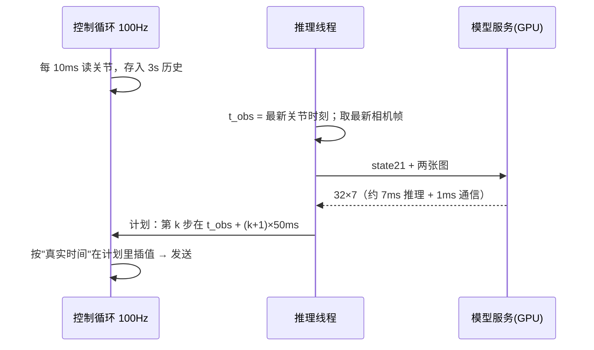

# 原理说明（通俗版）

## 1. 模型看什么、输出什么

| 项 | 内容 | 来源 |
|---|---|---|
| 状态 21 维 | 左臂 7（6 关节+夹爪）+ 右臂 7 + **右臂速度 7** | `config.json` + `act_observation_contract.json` |
| 速度 | `(现在的右臂位置 − 100ms 前的右臂位置) / 0.1s` | 契约 `velocity_slice=[7,14]`, `lag_frames=2 @20Hz` |
| 图像 | 左腕、右腕各一张 256×256 | `config.json` |
| 输出 | 32 步 × 7 维（右臂 6 关节 + 夹爪），每步 50ms，共 1.6s | `act_action_contract.json` |
| 关节 | **增量**：目标 = 拍照那一刻的关节 + 输出 | 契约 `right_joints_relative_to_observation` |
| 夹爪 | **绝对值**（0 闭 – 1 开） | 契约 `gripper: absolute` |
| 第 0 步 | 对应拍照后 +50ms | 契约 `action_offset_frames=1` |

> 为什么要速度？只看一张图 + 当前位置，模型分不清"正在往上抬"还是"正在往下放"。速度告诉它"现在在往哪边动"。

### 开局补零（padding）

训练时每段示范的**前两帧（前 100ms）速度都是 0**（还没有 100ms 前的数据）。部署时同样：执行开始后 100ms 内速度填 0，之后用真实历史计算。面板"速度输入"显示 `补零(开局)` / `正常`。

### 图像预处理与训练逐像素一致

`selftest` 会逐像素对比这条链路与训练转换代码的结果。

## 2. 时间对齐与时延

| 时延问题 | 处理 |
|---|---|
| 首次推理慢（CUDA 初始化、cudnn 选算法） | 服务启动时预热 10 次后才 READY；控制台再用**真实相机+状态**跑 5 次（实时预热） |
| GPU 空闲降频 → 停一会儿后第一次慢 | 服务空闲 > 1s 自动做一次空推理"保温" |
| 推理期间时间在流逝 | 计划按 t_obs 排时间，到达后直接按当前时间取值，不会"晚执行" |
| 下一个计划要提前要 | 分块模式在"计划用完前 = 实测最大往返延迟 + 15ms"就发请求 |
| 偶发卡顿 | 每个计划 1.6s，只用 0.5s，剩 1s 余量；用完 0.4s 还没新计划 → 急停 |
| 推理失败 / 相机过期 | 连续 3 次 → 急停（原地保持） |

## 3. 平滑

| 层 | 作用 |
|---|---|
| 三次插值（Catmull-Rom） | 20Hz 的 32 个点连成光滑曲线，100Hz 取值；速度连续，不会一顿一顿 |
| 分块提交 + 交叉淡化 | 一次跟一个计划；换计划时 0.15s 内从旧计划渐变到新计划 |
| 起步淡入 | 开始执行时从"保持姿态"渐变进第一个计划，不跳 |
| 时间集成（可选预设） | 多个计划在同一时刻的预测加权平均（ACT 原论文做法），最平滑但略滞后 |
| 安全过滤 | 限速（1.5 rad/s）、与实际位置偏差 ≤0.35 rad、关节在示范范围 ±0.15 rad 内 |
| 初始化/回零 | 五次多项式（最小加加速度）轨迹：起止速度、加速度都为 0；峰值 0.4 rad/s、0.8 rad/s² |

## 4. 安全层次

| 层 | 谁负责 | 触发后 |
|---|---|---|
| 硬件急停按钮 | 人 | 断电 |
| worker 看门狗：300ms 没收到指令 / 跟随误差 >1rad | worker 进程 | 原地保持（通电） |
| 控制台急停：空格 / Ctrl+C / 推理失败 / 计划耗尽 / 轨迹跟随误差 >0.35 rad | 引擎 | 原地保持，等待 z / i / r |
| 控制台崩溃 | worker 不随之退出 → 租约超时 → 原地保持 | `start.sh` 自动进入救援：平滑回零 → 断电 |
| 释放电机 | 只在零位进行 | 零力矩 |

> "零位"= 12 个关节全 0、夹爪张开 0.99。断电前一定先回到这里。
