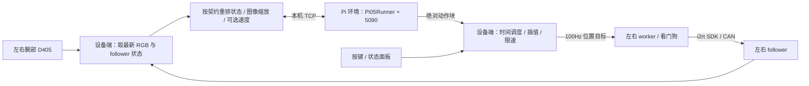

# π0.5 推理与部署方案

状态：用户已确认，进入实现。追加要求：推理关闭随机图像增强；启动时可选择夹爪 floor 滤波开关。依据：用户需求、两个本地参考仓库及 2026-11-03 对训练服务器的只读核对。

## 1. 采用的架构

用户已指定复用 ACT 工程结构、复制必要源码、使用 Pi 训练仓库的推理封装。因此采用 ACT 已有的**设备进程 + 模型进程 + 双臂 worker**结构，不另造通信和硬件控制系统。

| 方案 | 取舍 |
|---|---|
| 采用：原设备环境 + 独立 Pi 环境 | 保留 i2rt/RealSense/CAN 环境；模型库单独配置；复制 ACT 的本机 TCP 通信 |
| 不采用：把 Pi 全部装进设备环境 | 设备端 Python 3.10，训练端 Python 3.12；依赖变化可能影响已有控制 SDK |
| 不采用：服务器远程推理 | 用户要求在 Ubuntu 的 5090 本地推理；跨机器网络还会引入额外延迟 |

设备进程及源码不依赖两个参考工程的运行时源码路径；i2rt SDK 作为设备环境内已安装第三方库复用。新 Pi 环境是本方案的实现选择，未假定 ACT 的 LeRobot 0.4.4 可以直接运行 Pi 0.5。



## 2. 已核实的模型与硬件接口

| 项目 | 已核实值 |
|---|---|
| 蓝色积木 | `blue_block_2gpu_run1_18500steps`；右臂 7 维输出；查询时仍在训练 |
| 叠毛巾 | `fold_towel_1gpu_run1_10000steps`；双臂 14 维输出；已有 final |
| 开罐 | `open_canister_run1_10500steps`；双臂 14 维输出；已有 final |
| 当前三种模型输入 | follower 14 维，右臂在前；双腕相机；均 `use_velocity=false` |
| 动作时序 | `fps=30`，`chunk_size=50`，`n_action_steps=15`，采样起点为观测时刻，偏移 0 帧 |
| 图像 | RGB、等比缩放加黑边、224×224；模型 config 中左腕在右腕前 |
| 模型采样 | bf16；`num_inference_steps=10`；保留训练推理封装默认固定噪声种子，允许配置 |
| checkpoint | 每份 `model.safetensors` 实测 9,354,050,752 bytes；另需 config、契约、前后处理器 JSON 及各自 safetensors 统计 |
| tokenizer | 训练使用 `pretrained/paligemma_tokenizer`；需单独复制到部署工程并覆盖 checkpoint 中的服务器绝对路径 |
| 设备环境 | ACT 记录为 `<SI>/.venv/bin/python`，Python 3.10；含 i2rt、portal、RealSense、OpenCV、YAML |
| CAN | 右 follower=`can2`，左 follower=`can3`；不控制 leader |
| 相机序列号 | 左腕 `262622275249`，右腕 `262622272890`，来自 ACT 配置，待 Ubuntu 实物核验 |
| 控制频率 | 设备控制循环 100Hz；worker 独立保持与看门狗 |

### 输入输出边界（最重要）

1. 设备统一坐标：`[左6关节, 左夹爪, 右6关节, 右夹爪]`。
2. 模型输入严格按 `state_names` 重排；当前通常为右 7、左 7。
3. 复制 `Pi05Runner`、`load_checkpoint`、处理器构建、`predict_chunk`、夹爪滤波相关代码；剥离仅训练/数据集所需的依赖链，记录每处改动。
4. 模型内部预测相对关节量；后处理器加回**本次观测**的原始位置，夹爪保持绝对值；Runner 再做夹爪软下限滤波。
5. TCP 返回 `filtered` 绝对动作，不再执行 ACT 的相对量还原。按 `action_names` 映射到 robot14；右臂模型未控制的左臂维度保持本轮起始位置。
6. 形状、名称、有限数值、动作长度、模型与契约一致性必须校验。无契约、未知语义或缺统计文件时拒绝运行；不猜测。
7. 不在推理时执行训练的随机图像增强。菜单提供夹爪软下限 `checkpoint/on/off`，保留训练的 knee/floor 参数，单独覆盖 enabled；关闭仍限制到 [0,1]。写入日志并在面板显示。

### 可选速度与 padding

- 当前模型不拼速度，无需等待 100ms，也不额外增加 14 维。
- 后续速度模型：在状态后拼 14 维速度，按契约名称处理；采用 Pi 的过去 100ms 因果最小二乘斜率算法，不复制 ACT 差分规则。
- 训练源码没有 ACT 那种“固定前两帧清零”规则；不足两点时退化到最近两点，再不足则补零。原始数据起点和裁剪后 episode 起点也不同，不能人为给每轮任务前 100ms 全清零。
- 部署在开局上电保持期间累计历史；计算窗口和所用样本时间必须可记录。历史不足时只使用已存在的真实样本，禁止捏造过去姿态；不足两点的速度为零并显示 padding 状态。
- 训练 checkpoint 未完整携带预处理速度窗口；提供部署输入配置/可选元数据旁文件，已知本批模型窗口为 0.1s。未来窗口变化需明确声明，不从维数猜。
- 硬件读取频率与原始采集频率不完全相同：复用相同估计方法，实际速度分布仍需上机核验，不能声称逐样本完全一致。

## 3. 目录、复制范围与扩展边界

```text
Pi-deployment-fish/
  agents.md / changelog.md / README.md
  start.sh / local.env.example / requirements.txt
  configs/ deploy.yaml / tasks.yaml / hardware.yaml
  checkpoints/<task>/<run>/<checkpoint>/  # 完整训练 checkpoint
  pretrained/paligemma_tokenizer/
  pi_deploy/
    model/       # 契约、状态/图像适配、绝对动作映射
    inference/   # 从 Pi 训练仓库复制的推理封装及必要依赖
    server/      # GPU 模型进程、预热、健康状态
    control/     # 历史、调度、限速、平滑轨迹
    hw/          # 双臂 worker、RPC、相机、预检
    app/         # 状态机、交互菜单、状态面板、记录
    tools/       # 自检、自测、GPU 基准、救援
  docs/          # 中文流程、环境部署、复制来源、验收记录
  tests/ / logs/
```

| 来源 | 复制与适配 |
|---|---|
| ACT `hw/` | 复制相机、机械臂客户端、worker、看门狗、硬件配置；更换包名和日志归属 |
| ACT `ipc.py` | 复制 numpy+JSON 本机协议，Pi 使用独立协议标记；严格验证数组与请求身份 |
| ACT `control/` | 复制轨迹与调度；时序取 Pi 契约的 30Hz；速度估计用 Pi 方法 |
| ACT `app/`、`tools/`、`start.sh` | 复制菜单、控制台、状态机、记录与救援；增加 Pi 参数、预热门禁与失效结果处理 |
| Pi `inference.py`、`policy_factory.py`、`gripper.py`、`images.py` 等必要片段 | 复制推理代码；替换本地 import，避免拉入 MCAP、训练器或完整数据集模块 |

所有副本来源与差异写入 `docs/vendored.md`。内部函数拆分、IPC 字段名和配置校验实现由开发者决定；新增配置必须解释用途与单位。

## 4. 启动、执行与交互

| 阶段 | 行为 / 面板说明 |
|---|---|
| 菜单 | 选任务 → 递归扫描任务目录中的完整 checkpoint → 选权重 → 选模式；默认从 checkpoint 的 `n_action_steps` 得到执行步数 |
| 模型准备 | 在**机械臂上电前**核对文件、加载并校验权重、完成合成输入预热；失败直接退出并显示日志 |
| 硬件准备 | 检查端口/CAN → 启动 worker 原地保持 → 打开相机 → 启动 100Hz 控制循环 |
| 实时预热 | 用真实相机和 follower 状态推理，输出全部丢弃；未通过时禁止进入策略执行，但允许急停/回零/退出 |
| 第一次 Enter | 平滑移动到 ACT 固定初始姿态，实际到位后 READY |
| 第二次 Enter | 开始本轮任务，异步推理与控制循环同时运行 |
| f / 人工结束 / 时长到达 | 停止本轮，清空旧计划，经初始姿态平滑回零，停留 ZERO 等指令 |
| 空格 | 软件急停：停止采用策略输出，保持；z 在通信及反馈健康时平滑直接回零 |
| p | 暂停/继续；继续前丢弃暂停前尚未返回的推理 |
| z | 请求回零；策略执行中也可直接提出请求，不要求先记住其他组合键；异常时先验证恢复条件 |
| r / q | 平滑回零，确认到位后释放电机、相机、模型服务并退出 |
| 程序异常退出 | worker 保持，启动器提示并提供救援回零；不因主进程崩溃直接令机械臂掉落 |

- `sim`：模拟机械臂与相机，真实 Pi 推理；另有明确标记的 mock 后端供离线控制逻辑验收，不能把它当 GPU 验证。
- `shadow`：真实机械臂、相机、模型；**仍会做初始化与回零**，任务执行阶段保持并显示预测。
- `real`：真实模型驱动机械臂。
- 任务成功暂由操作者判断（f 结束）。关节模型没有通用成功信号；不凭“夹爪闭合”宣称任务成功。
- 普通任务结束无论人工判断成功或失败都回零；碰撞、状态不可信、通信中断等故障先保持，不能为满足“失败后回零”强行自动运动。
- 初始化、回零均用 ACT 五次多项式轨迹（起停柔和），继承速度/加速度限制；**到位超时不继续执行或断电**，转保持并显示偏差。
- ACT 中“IDLE 直接释放”“到位超时继续”等分支不原样沿用；释放必须满足零位到达条件。恢复出错保持，不自动重启整轮任务。

所有任务使用 ACT `configs/tasks.yaml` 已记录的同一固定 `start_pose`，逐值复制；零位也是 ACT 的 `[0,0,0,0,0,0,0.99] × 2`。初始姿态是用户要求的兼容基准，不能据此推断对所有物体摆放都无碰撞。

## 5. 时延与动作执行

- 一块 50 步、30Hz 的动作覆盖约 1.67 秒；默认重规划目标为 15 步，即约 0.5 秒。两者分别是“模型看多远”和“多久更新一次”。
- 模型加载、合成预热、实时预热分别报告状态和耗时；CUDA 计时前后同步，记录首轮、稳态 p50/p95、端到端耗时和显存。
- 异步提前请求下一块，100Hz 控制不等待 GPU；按观测时间安排每个目标的执行时刻，已经过去的点不从头补播。
- 启动前根据预热耗时和动作覆盖长度判断是否有足够时间余量；余量不足则阻止 real 执行并提示减少推理开销或调整执行配置，不静默发旧动作。
- 每次开始、暂停、继续、结束、急停均更新执行代号；服务结果必须同时匹配当前代号与请求身份，防止“暂停前的结果在恢复后才到达”而误执行。
- 迟到至无剩余覆盖时间的结果直接丢弃；首块迟迟不返回、连续推理失败、动作块耗尽、帧/反馈过期时转保持。
- 插值、计划切换淡入、关节限速与目标偏离限幅继承 ACT；动作范围不能从**相对动作**归一化统计直接当成绝对关节限位。
- 软件的速度/偏差限制和 worker 看门狗不构成碰撞检测，也不能替代物理急停。

## 6. 环境与权重搬运

- 保留设备环境。Pi 建独立 Python 3.12 环境，主要库与服务器实查对齐：LeRobot 0.6.1、transformers 5.5.4、safetensors 0.8.0、numpy 2.2.6、huggingface_hub 1.33.0。
- 训练端 torch 为 2.8.0+cu126；5090 端采用 torch 2.8.0+cu128、torchvision 0.23.0+cu128。驱动、CUDA 运算、bf16、实际显存和速度需在 Ubuntu 验证。
- 普通依赖走中科大 PyPI 源；PyTorch CUDA wheel 走官方 cu128 索引。安装指南说明 CUDA wheel 与系统 toolkit 的区别，并提供 `pip check`、GPU 实际运算与离线推理命令。
- 整份 checkpoint 和 tokenizer 放本工程中；不要求再拷一份 pi05_base 大权重。保留可配置绝对路径，默认解析相对工程目录。
- 权重搬运在用户环境中显式执行，保留源端，跳过 `.partial` 产物。工程提供命令与清单，不擅自下载每个约 9.35GB 的权重。
- 默认运行启用 HF 离线模式，不回退联网下载，不加载服务器上不存在于本机的绝对路径。

官方依据：[PyTorch 2.8.0 cu128 安装组合](https://pytorch.org/get-started/previous-versions/)、[Blackwell 与 CUDA 12.8 支持](https://pytorch.org/blog/pytorch-2-7/)。库 API 以训练端实际安装版本及已验证的本地 Pi 封装为准。

## 7. 分板块验收与交付

| 板块 | 集中验收内容 |
|---|---|
| 模型适配 | 右/双臂命名映射、无速度/有速度、padding、图像顺序/大小、绝对输出不重复加状态、缺文件拒绝 |
| 控制与状态机 | 初始化→运行→结束→回零→等待；暂停/急停后的旧结果丢弃；过期计划、首块超时、故障、未到位禁止释放 |
| 启动器与文档 | 启动参数、任务/权重菜单、模拟无硬件运行、脚本语法、环境自检和救援入口 |
| Ubuntu GPU（待可连接） | 完整真实权重加载校验、真实推理数值/形状、首轮与稳态时延、显存、通信全链路 |
| 真机（待明确允许） | CAN/相机实物核对、软件急停、初始化/回零、shadow，再小范围 real |

测试遵循用户要求，按板块集中进行，不每个小改动单独跑测试。每板块更新 changelog；不能把 mock、CPU 或服务器 H20 结果写成 RTX 5090 或真机验收通过。

代码已按确认方案实现并完成离线验收，详见 validation.md。没有连接 `mvig-ubuntu`、向目标主机安装依赖、搬运大权重或执行机械臂；真实 GPU/硬件验收保留可复现工具与明确待办。最终审阅后，遗留worker救援改为显式 `--rescue`，支持单侧存活worker；模拟模式及异常退出不隐式启动救援运动。
