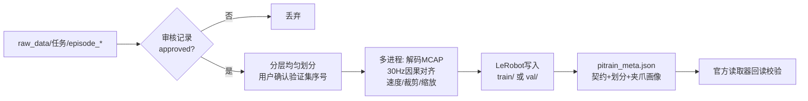

# changelog — 开发记录

> 规则：列表/流程图优先；每个板块完成后追加一节。新的在最下面。

---

## 0. 调研与决策（开发前）

### 0.1 我看了什么
- 原始数据 `blue_block_v2/episode_xxxx/`：每条 = 1 个 `.mcap` + `metadata.json` + `episode_stats.json`
- 审核记录：100 条中 **80 approved / 20 rejected**
- 旧 ACT 仓库：只借鉴了「MCAP 读取方式、因果时间对齐、按 episode 划分、训练集统计」这几个思路
- 服务器（只读查询）：4×H20 96GB、驱动 535 / CUDA 12.6、**HF 官网不通、hf-mirror 可用**、PyPI 可用、共享盘仅剩 1.8T

### 0.2 原始数据长什么样（episode_0000 实测）

| topic | 频率 | 内容 |
|---|---|---|
| `follower/{left,right}/joint` | 90Hz | 从臂 6 关节角 (rad) |
| `follower/{left,right}/hand_state` | 30Hz | 从臂夹爪 [0,1]，1=张开 |
| `leader/{left,right}/joint` | 90Hz | 主臂 6 关节角 |
| `leader/{left,right}/hand_state` | 30Hz | 主臂夹爪 |
| `camera_0` / `camera_1` / `camera_2` | 30Hz | 右腕 / 左腕 / 头部（**头部是合成黑帧，丢弃**）JPEG 640×480 |

- 左臂全程几乎不动（关节变化 < 0.1 rad）→ 默认只预测右臂
- 夹爪抓住积木时（抽查 8 条）：

```
主臂 leader 夹爪 ≈ 0.00 ~ 0.20   ← 操作员捏紧的程度，因人而异
从臂 follower 夹爪 ≈ 0.28 ~ 0.33 ← 被积木挡住，停在积木宽度
```

### 0.3 关键决策

| 问题 | 决策 | 一句话理由 |
|---|---|---|
| 框架 | LeRobot 0.6.1 + `lerobot/pi05_base` | PyTorch、pip 可装、原生支持相对动作和多卡 |
| 采样频率 | 30Hz（相机原生频率） | 不重复/丢帧；chunk=50 ≈ 1.67s |
| 相对动作 | 关节相对、夹爪绝对 | 与 OpenPI 官方做法一致；夹爪相对化没有物理意义 |
| 夹爪标签 | **用 leader** + 推理端软下限滤波 | 用 follower 会学成"刚好碰到"而夹不紧；直接用 leader 会夹太猛 |
| 速度 | 两版都保留，默认**不加** | pi0.5 官方只用当前 state；速度可能带来"抄近路"（详见文档） |
| 权重保存 | top-k best + final，不存优化器 | 单个权重 ~7GB，优化器状态再 ~14GB，磁盘紧张 |
| 曲线 | TensorBoard + CSV + PNG | 成熟方案，离线可看 |
| tokenizer | `google/paligemma-3b-pt-224` 需授权；备用社区镜像 | 服务器只能走 hf-mirror |

---

## 1. 预处理板块 ✅

### 1.1 新增文件

```
pitrain/nedf3.py        读 MCAP（按内嵌 protobuf 描述符动态解码）
pitrain/review.py       读审核记录 → 只留 approved，校验 sha256
pitrain/split.py        分层均匀划分验证集
pitrain/timeseries.py   30Hz 因果对齐 / 速度 / 首尾静止裁剪
pitrain/images.py       JPEG → RGB → 224×224 letterbox
pitrain/gripper.py      夹爪软下限滤波 + 从数据估计参数
pitrain/preprocess.py   写 LeRobot v3 数据集（train/ val/）
pitrain/cli/preprocess.py  交互式一键脚本
configs/preprocess_defaults.json
```

### 1.2 流程



### 1.3 验收测试（本地，前 6 条 episode）
- ✅ 5 train / 1 val，3037 + 524 帧，用时 54s（3 进程）
- ✅ 回读：图像 3×224×224、state 14、velocity 14、action 7、带 q01/q99 分位数统计
- ✅ 抽帧可视化：右腕/左腕颜色正确（蓝色积木为蓝色）
- ✅ 夹爪画像：抓持时从臂中位 0.311、主臂 0.176 → 建议 knee=0.361, floor=0.231
- 体积：约 57MB/条 → 80 条约 4.6GB
- 🐞 修复：ns 时间戳(1.8e18)超出 float64 精度，网格起点被舍入到首帧之前 → 改为整数偏移相加

### 1.4 发现的问题（留给训练板块处理）
- 左臂几乎静止 → 该维 q01≈q99 → pi0.5 的分位数归一化会**把噪声放大成巨大的数**
  - 处理：训练时给每个维度的 [q01, q99] 设置最小跨度（见训练板块）

---

## 2. 训练 / 评测 / 报告 / 一键脚本 ✅

### 2.1 新增文件

```
pitrain/hparams.py         超参数 + 随数据量自动默认值
pitrain/data.py            state 组装(可含速度)、分位数最小跨度保护、相对动作统计
pitrain/policy_factory.py  构建 pi0.5 / 处理器、权重加载强校验、prompt 长度自动计算
pitrain/schedule.py        warmup + cosine / StepLR / constant
pitrain/validation.py      固定随机数的 val_loss + 真推理 val_nmae
pitrain/train.py           Accelerate 多卡训练、top-k + final 保存
pitrain/evaluate.py        多 GPU 子进程推理、8 项指标打分、分关节图
pitrain/inference.py       推理封装（评测/部署共用，含夹爪滤波）
pitrain/report.py          HTML 报告 + <名称>_statistics.zip
pitrain/pipeline.py        训练 → 评测 → 打包
pitrain/cli/train.py       交互式一键训练
scripts/*.sh               一键脚本
```

### 2.2 开发中发现并处理的问题
- 🐞 LeRobot `from_pretrained` 加载失败时**只打印警告并返回随机模型** → 加了权重比对校验
- 🐞 含速度时 prompt ≈210 token，超过默认上限 200 会**截掉 "Action:"** → 改为按 state 维度自动计算（不含速度 96、含速度 ~224）
- ⚠ 服务器无中文字体 → 图内用英文，中文说明放 HTML

### 2.3 验收测试（本地 CPU，微型同结构网络）
- ✅ 训练 6 步：loss 1.81→1.57，验证 2 次，top-k 保存与淘汰、final 保存、StepLR 生效
- ✅ 评测：推理 524 帧、打分排名、分关节图 + 对比图
- ✅ 报告 zip 1.2MB（html + 曲线 + 图 + csv/json，不含权重）
- ✅ pyright 0 错误；ruff 通过
- ⏳ 待服务器验证：真实权重显存/速度、2/4 卡 DDP

---

## 3. GPU 等待训练与 FIFO 队列（2026-11-02）

- 新入口：`bash scripts/train_wait.sh`，照搬 `train.sh` 环境初始化，复用原有全部交互/配置与「训练 → 评测 → 打包」流水线。
- 流程：参数选择完成 → 后台入队 → 检查显存与 GPU 利用率 → 队首空闲卡足够 → 锁定精确数量 GPU UUID → 原流水线 → 释放 GPU。
- 默认标准：显存占用 ≤ 1024 MiB **且**利用率 ≤ 10%，每 10 秒检测；阈值与间隔均可通过参数调整。
- 多任务：严格 FIFO；运行任务保留每卡文件锁至流水线结束，剩余卡可启动后续任务；队首卡数不足时不插队。
- 可观测性：`--queue-status`、`queue_status.json`、原有 `status.json` / `pipeline.log` / `pipeline.pid`；默认后台进程不受 SSH 断开影响。
- 异常处理：采集失败继续等；僵尸队首清理；提交写入失败清理；取消/流水线崩溃清理进程组后释放锁；监控意外退出时流水线继承的 GPU 锁继续生效。
- 修改边界：原 `train.sh`、训练、评测、打包代码保持原样；原 CLI 仅增加可选的启动回调；未新增依赖、未复制数据或权重。
- 使用说明：`docs/train_wait.md`。
- 最终集中验收（服务器 `pi_fish` 环境）：`python -m unittest tests.test_gpu_queue_acceptance -v`，**10 项全部通过（14.669 秒）**。
  - 原参数/配置与 dry-run；显存+算力双阈值、未知指标；非连续 GPU UUID 分配；FIFO 与空闲卡并行；运行中 GPU 锁互斥。
  - 监控被强杀后的队首清理与锁继承；NVML 失败重试；流水线失败释放；前后台取消；提交写入失败不死锁；流水线崩溃清理训练子孙；CUDA 可见编号映射。
  - `bash -n`、Python 编译、真实 CLI 帮助/队列、真实 `nvidia-smi` 只读采集和部署 SHA256 校验通过；原 `train.sh` / `pipeline.py` 哈希保持一致。
  - 只在临时目录模拟 GPU 与训练边界，未启动真实训练、未占用训练 GPU；验收后清理临时任务。

## 4. 根据两卡实测放宽 GPU 调度阈值（2026-11-03）

- 依据：两卡、每卡 batch 16、BF16/梯度检查点的历史训练峰值为每卡 49.2 GB（PyTorch 分配），当前两卡训练的 `nvidia-smi` 每卡约 49,800 MiB；相似排队配置估算每卡 50–55 GiB，调度预留至少 60 GiB。
- 新默认：已用 ≤ 32768 MiB（32 GiB）、实际剩余 ≥ 61440 MiB（60 GiB）、利用率 ≤ 10%；10 秒轮询不变。GPU 0 已用 29617 MiB / 实际剩余 67668 MiB / 利用率 0%，满足新标准。
- 只修改等待调度：采集实际 `memory.free`；新增 `--min-free-memory-mb`；新版等待监控每轮读取阈值。
- `--update-waiting` 将阈值应用于现有等待条目；旧监控在全局锁下交接，沿用原任务 ID/提交时间/顺序/配置/命令/环境，更新监控 PID；运行任务不变。
- 交接保护：写前硬链接备份、失败原子回滚、TERM/HUP/中断恢复旧监控；不取消或重新提交任务。
- 原训练入口、训练/评测/打包代码、所有现有训练配置不修改；未增加显存探测训练。
- 最终集中验收：服务器 `pi_fish` 环境下 **14 项全部通过（27.564 秒）**；临时目录模拟 GPU/训练，覆盖剩余显存门槛、阈值热读、旧监控交接保持 FIFO/配置/运行任务、交接写入失败及 TERM 回滚；未启动探测训练。
- 已应用到 3 个真实等待任务，原 ID、提交时间、顺序和全部 `train_config.json` 哈希保持不变；运行任务监控身份与 GPU 分配不变。
  - `fold_towel_2gpu_run2_14000steps_8action`：监控 PID `1599446 → 1604324`。
  - `open_canister_2gpu_run2_15000steps_8action`：监控 PID `1600189 → 1604325`。
  - `blue_block_2gpu_run2_25000steps_withspeed`：监控 PID `1601534 → 1604326`。
- 新等待监控已开始轮询；当时只有 GPU 0 满足标准，因此两卡任务仍按原顺序等待第二张卡。
