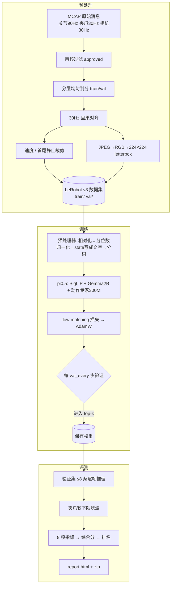

# 流程详解：数据从哪来、变成什么、模型怎么学、怎么评

## 全景图



---

## 1. 预处理

### 1.1 数据从哪里提取

| 用途 | MCAP topic | 说明 |
|---|---|---|
| state（输入） | `follower/{right,left}/joint` + `hand_state` | 从臂：机器人"实际在哪" |
| action（标签） | `leader/right/joint` + `hand_state` | 主臂：操作员"想让它去哪" |
| 图像（输入） | `camera_0`(右腕) `camera_1`(左腕) | 头部相机是全黑合成帧，丢弃 |

### 1.2 经过了什么转换

| 步骤 | 做什么 | 为什么 |
|---|---|---|
| 审核过滤 | 只留 `decision=approved`，校验 sha256 | 坏数据不进训练 |
| 分层划分 | 按编号分 k 段，每段抽 1 条做验证 | 验证集覆盖整个采集过程 |
| 30Hz 对齐 | 每个网格点取"之前最新的一帧" | 与部署时只能看到过去一致 |
| 速度 | 过去 0.1s 原始 90Hz 采样做直线拟合取斜率 | 比两帧差分抗噪 |
| 静止裁剪 | 去掉开头/结尾主臂不动的部分（各留 0.5s） | 防止模型学会"开局发呆" |
| 图像 | 640×480 → 等比 224×168 → 上下补黑边 | pi0.5 视觉编码器输入 224×224，不变形 |

### 1.3 最终以什么形式呈现

```
dataset/<名称>/
  train/  val/        LeRobot v3 数据集（parquet，图像为内嵌 PNG）
  pitrain_meta.json   每一维的含义、fps、prompt、划分名单、夹爪画像
  review/             审核记录副本
```

每一帧包含：

| 字段 | 形状 | 含义 |
|---|---|---|
| `observation.state` | 14 | 从臂 [右6关节,右夹爪,左6关节,左夹爪]（**动作臂在前**） |
| `observation.velocity` | 14 | 从臂速度 |
| `observation.leader_state` | 14 | 主臂（只用于画图） |
| `action` | 7（或14） | 主臂右臂绝对位置 |
| `observation.images.*` | 224×224×3 | 两路腕部相机 |
| `task` | 文本 | 例 "Pick the blue block ... into the blue cup." |

> 为什么动作臂要排在 state 最前面？LeRobot 做相对动作时按 `action - state[:动作维度]` 对齐相减。

---

## 2. 模型训练

### 2.1 输入与输出

```
输入:  两张 224×224 图像
       + 文字 "Task: <指令>, State: 128 37 255 ...;\nAction: "   ← state 被离散成 0~255 写进文字！
输出:  未来 50 步(≈1.67s) 的动作 chunk [50 × 7]
       关节 = 相对当前从臂的变化量（弧度），夹爪 = 绝对值
推理后: 关节 + 当前 state = 绝对目标；夹爪 → 软下限滤波 → 发给机器人
```

### 2.2 架构（约 3.6B 参数）

```
图像 ──▶ SigLIP 视觉编码器(400M) ──▶ 256 个图像 token/张 ─┐
文字 ──▶ 分词器 ──▶ 文本 token ─────────────────────────────┼─▶ Gemma 2B (VLM 主干)
                                                             │        │ 注意力共享
带噪动作 + 时间 t ──▶ 动作专家 Gemma 300M ◀────────────────────┘◀───────┘
                          │
                          ▼ 输出"去噪速度"
```

**flow matching 是什么**（通俗版）：训练时把真实动作和随机噪声按比例 t 混合，让模型预测"从噪声走向真实动作的方向"。推理时从纯噪声出发，沿模型给的方向走 10 小步，就得到动作。与扩散模型类似，但更快、更稳。

### 2.3 损失、优化器、学习率

| 项 | 设置 | 说明 |
|---|---|---|
| 损失 | flow matching MSE（归一化空间） | 预测速度 vs 真实速度 |
| 优化器 | AdamW β=(0.9,0.95) wd=0.01 | 与 OpenPI 官方一致 |
| 梯度裁剪 | 1.0 | 防止偶发大梯度 |
| 学习率 | 默认 2.5e-5，按全局 batch 平方根缩放 | |
| 调度 | warmup → cosine 降到 10%（默认）或 StepLR | StepLR 可开关、可设间隔与 gamma |
| 精度 | bf16 混合精度 + 梯度检查点 | 省显存 |
| 多卡 | Accelerate DDP，全局 batch 平分到每卡 | 1/2/4 卡 |
| 增强 | 颜色/锐度/轻微平移 | 小数据集防过拟合 |
| 归一化 | 分位数 q01/q99 → [-1,1]，每维最小跨度保护 | 防止静止的左臂噪声被放大 |

### 2.4 验证与保存

每 `val_every` 步：
- `val_loss`：固定噪声的 flow matching 损失
- `val_nmae`：真推理（10 步去噪）后与主臂比较，误差÷该维幅度 → **用它挑 best**
- 进入 top-k 就保存（~7GB），挤出最差的；结束时另存 `final`

---

## 3. 夹爪方案

| 方案 | 问题 |
|---|---|
| 标签用从臂 | 抓住后从臂停在 0.30，模型就只命令 0.30 → 几乎没有夹持力，容易滑落 |
| 标签用主臂，直接输出 | 主臂被捏到 0~0.2 → 从臂被命令到远低于积木宽度 → 夹得过猛 |
| **✔ 标签用主臂 + 软下限滤波** | 模型正常学"何时、多用力合拢"，输出端平滑限幅 |

```
g ≥ knee : 输出 = g                      （张开/松开不受影响）
g < knee : 输出 = floor + (knee-floor)·exp((g-knee)/(knee-floor))
```

默认参数由训练集估计：`floor ≈ 抓持时从臂中位数 − 0.08`，`knee ≈ 中位数 + 0.05`（本数据约 0.23 / 0.36）。
想夹更紧就调小 floor（在 `dataset/<名称>/pitrain_meta.json → gripper_profile.suggested`）。

## 4. 速度要不要加？

| | 不加（默认） | 加 |
|---|---|---|
| 优点 | 与官方一致；不易"抄近路" | 单帧看不出运动方向，速度能补充 |
| 风险 | 静止与运动中的同一姿态可能混淆 | 模型可能只按当前速度外推、忽视图像（因果混淆）；prompt 变长约 90 token，训练变慢 ~10% |

建议：先跑不加的版本做基线，再跑加速度版本对比评测分数。

## 5. 评测打分

在验证集抽 ≤8 条，对每个保留权重逐帧推理：

| 指标 | 权重 | 含义 |
|---|---|---|
| 关节误差·近期 | 0.25 | 每次真正执行的前 n 步 |
| 分段执行轨迹误差 | 0.20 | 每 n 步重新推理拼成的轨迹 |
| 整段 chunk 误差 | 0.10 | 远期规划 |
| 95 分位误差 | 0.10 | 偶发大错 |
| 夹爪误差 | 0.10 | 原始输出 |
| 夹爪开合 F1 | 0.10 | 开/合判断是否一致 |
| 首次闭合时机 | 0.05 | 抓取时机 |
| chunk 衔接跳变 | 0.10 | 平滑性 |

子分 = 100·exp(−误差/容差)，综合分 = 加权平均。权重/容差可在 `configs/eval_scoring.json` 修改。
**注意**：这是离线开环评测，只说明"在示范状态下能否复现主臂动作"，不等于真机成功率。
